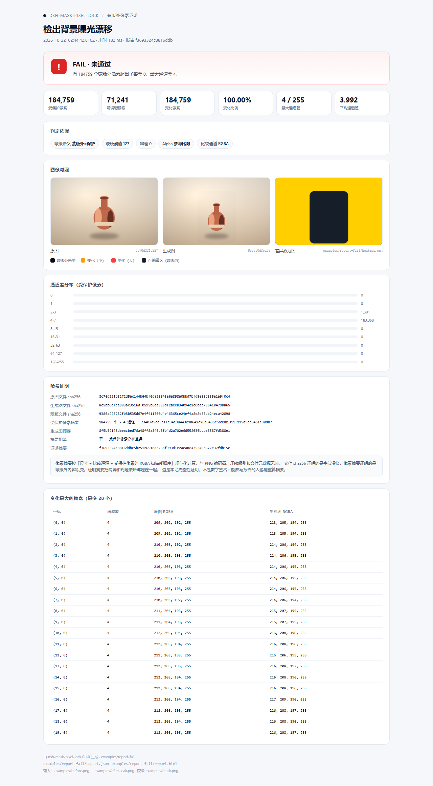

# dsh-mask-pixel-lock

[](https://github.com/dingchenhui0618-arch/dsh-mask-pixel-lock/actions/workflows/ci.yml)
[](LICENSE)

> 局部改图之后，**蒙版外的每一个像素是否还和原图逐字节相同？**
> 三张 PNG 进去，一句可 `grep` 的结论、一张差异热力图、一份可复算的 SHA-256 证明出来。

> 用着还行的话，点个 ⭐ 就够了——插件市场的「搜插件」按 GitHub star 排序，star 是这个插件能被人翻到的唯一杠杆。



这是 DeepSeek Harness 的插件，同时也带一个零依赖 CLI。全部在本地完成：不调用模型、不联网、不上传图片。

## 它解决什么

生成式改图（inpainting、扩图、换主体、抹除物体）有一个很容易被忽略的问题：**主体确实改了，但背景也被悄悄重绘了。** 模型或流水线说「只动了蒙版区域」，肉眼很难复核；整图 diff 又会被主体区域的大量变化淹没。

这个插件只回答一个可以被像素复核的问题：

1. 蒙版之外，是否每个像素都与原图相同？
2. 如果不同，差在哪、差多少、最大差是多少？
3. 同一组文件、同一套策略，能否被第三方复算出同一个结论？

它不做内容识别，也不判断「改得好不好看」。它只做确定性比较。

## 和截图 diff 的区别

本机已有一个 `dsh-vision-diff`：比较**两张截图**，回答「同一屏两次渲染变没变」，用忽略矩形排除时钟、光标等区域，服务的是视觉回归。

本插件比较的是**原图 + 蒙版 + 生成图**三张图，回答「蒙版外有没有被改」，服务的是改图交付验收：

| | dsh-vision-diff | dsh-mask-pixel-lock |
|---|---|---|
| 输入 | 两张截图 | 原图、生成图、蒙版 |
| 比较范围 | 整图减去忽略矩形 | 蒙版语义决定受保护区 |
| 结论 | 变没变、变在哪 | 蒙版外是否逐字节相同 |
| 证明 | 差异区域与统计 | 文件 SHA-256 + 受保护像素摘要 + 证明摘要 |
| 典型场景 | UI 回归 | 局部改图验收 |

两者互补，不存在替代关系。**本插件没有复用 `dsh-vision-diff` 的代码**；它的 PNG 编解码、比较、证明和报告都是本仓库独立实现的。

## 安装

GitHub 直装：

```sh
dsh plugin --profile <你的 profile> add github:dingchenhui0618-arch/dsh-mask-pixel-lock
```

本地开发目录：

```sh
dsh plugin --profile <你的 profile> add D:\Projects\dsh-mask-pixel-lock
```

桌面端在应用内的插件管理里安装本地目录或 GitHub 地址即可，profile 由应用管理，不需要手敲上面的命令。

包只声明 `dsh.bundle`，没有运行时依赖，也没有安装脚本；`lib/` 是入库的预构建产物，装的时候不会现场编译。

装好后：对话视图里出现「像素锁」Tab；agent 侧出现 `mask_pixel_lock_verify` 工具。

## 工具用法

```json
{
  "original": "D:\\shots\\before.png",
  "generated": "D:\\shots\\after.png",
  "mask": "D:\\shots\\mask.png",
  "maskMode": "edit",
  "label": "主体左移 12px，背景不动"
}
```

| 参数 | 必填 | 默认 | 说明 |
|---|---|---|---|
| `original` | 是 | — | 原图 PNG 路径，绝对路径或相对宿主进程 cwd |
| `generated` | 是 | — | 生成图 PNG，尺寸必须与原图一致 |
| `mask` | 是 | — | 蒙版 PNG，尺寸必须与原图一致 |
| `outputDir` | 否 | 生成图旁的 `mask-pixel-lock-<UTC 时间>` | 报告输出目录；已存在时自动加 `-2`、`-3` |
| `maskMode` | 否 | `edit` | `edit`：蒙版内可改、蒙版外受保护；`lock`：蒙版内受保护、蒙版外可改 |
| `maskThreshold` | 否 | `127` | 蒙版墨量达到该值才算「画上」 |
| `tolerance` | 否 | `0` | 通道差超过该值才算变化；`0` 即严格逐字节 |
| `ignoreAlpha` | 否 | `false` | 为 `true` 时只比较 RGB |
| `label` | 否 | `''` | 写进报告的说明 |

工具返回紧凑结构（`ok`、`verdict`、`summary`、`comparison`、`proof`、`outputs`），完整细节在 `report.json` / `report.html`。

一次真实运行：

```
MASK_PIXEL_LOCK=FAIL
受保护像素 184759 / 变化 184759 / 最大通道差 4 / 容差 0
像素证明 不同 · 73407d5ca9a1fc34e98443e9a642c20e8435c5bd9b1311f225a9aa8451e30db7
证明摘要 f3693324c8816ddbc5b2512651eae26af993d1e2aea8c435349b672e37fdb15e
热力图 examples/report-fail/heatmap.png
报告 examples/report-fail/report.html
```

## 蒙版语义

这是全插件最容易用错的部分，先看这里。

**墨量**：对蒙版每个像素，`ink = 亮度 × alpha / 255`。纯白不透明 = 255，纯黑或全透明 = 0。灰度蒙版可以用 `maskThreshold` 调整「算不算画上」的界线。

**`edit` 模式（默认）**：蒙版是「可编辑区」，蒙版之外是受保护区。适合「只允许改这一块」的局部改图。

**`lock` 模式**：蒙版是「受保护区」，蒙版之外可改。适合「这块不能动，其他随便」的场景，例如保护 Logo、水印区、人物身份证件。

受保护的像素集合会以 `policy` 与 `comparison.editablePixels` 写进报告；`EMPTY` 表示受保护像素为 0，**它不等于 PASS**——没有被保护的对象，就什么都没证明。

## 输出

每次校验写三个文件：

- `heatmap.png`：差异热力图。近黑 = 受保护且未变；暗蓝灰 = 可编辑区；琥珀 → 红 = 受保护但变了，越红通道差越大。一级差异也会直接显示为琥珀色，不会被整图缩放吞掉。
- `report.json`：机器可读的完整报告，schema 为 `dsh-mask-pixel-lock/report@1`。
- `report.html`：自包含中文报告页，三张图以 base64 内嵌，断网也能打开。

仓库里有两份用合成素材生成的样例：

- [PASS 报告](examples/report-pass/report.html) / [PASS JSON](examples/report-pass/report.json)
- [FAIL 报告](examples/report-fail/report.html) / [FAIL JSON](examples/report-fail/report.json)

样例图是 `examples/before.png`、`examples/after.png`、`examples/after-leak.png`、`examples/mask.png`，由 `examples/generate_examples.py` 生成。`after.png` 只把花瓶缩小，蒙版外逐字节不变；`after-leak.png` 在蒙版外加了 +4/+3/+2 的曝光漂移，正是要被抓住的情况。

## 证明怎么读

报告里有三组哈希，含义不同：

| 字段 | 证明什么 |
|---|---|
| `proof.files.original/generated/mask` | 文件字节的 SHA-256。换一张图、重新编码、改元数据都会变 |
| `proof.protectedPixels.original/generated` | 把受保护像素按「尺寸 + 比较通道 + RGBA 扫描线顺序」规范化后的摘要。与 PNG 编码器、压缩级别、文件元数据无关 |
| `proof.proofDigest` | 把 schema、版本、策略、三个文件哈希、两个像素摘要绑在一起的总摘要 |

所以：

- 文件哈希相等 ⇒ 字节没换；
- 像素摘要相等 ⇒ 蒙版外内容没变，哪怕 PNG 被重新压缩；
- 证明摘要相等 ⇒ 同一组输入 + 同一套策略得出了同一份结论。

**它不是数字签名。** 能改写报告的人也能重算摘要。它是一份本地完整性声明，不是可信时间戳，也不证明「这张图是谁生成的」。要抗篡改，需要把 `proofDigest` 记到外部系统（仓库、工单、日志）里。

`tolerance > 0` 时，允许「像素证明不同但判定 PASS」：报告会明确写出警告，`comparison.exactChangedPixels` 也会保留严格计数。做交付验收时建议用 `tolerance: 0`。

## CLI

```sh
node bin/mask-pixel-lock.mjs \
  --original examples/before.png \
  --generated examples/after.png \
  --mask examples/mask.png \
  --out examples/report-pass \
  --label "主体缩小 18%，背景光影保持不变"
```

选项：`--out`、`--mask-mode edit|lock`、`--threshold 0-255`、`--tolerance 0-255`、`--ignore-alpha`、`--label`、`--json`、`--help`、`--version`。

退出码是契约的一部分：

| 码 | 含义 |
|---|---|
| `0` | PASS |
| `1` | FAIL |
| `2` | 输入错误（文件不存在、不是 PNG、蒙版尺寸不符……） |
| `3` | EMPTY（没有受保护像素，不能算通过） |

`--json` 把完整报告打到 stdout，适合接 CI：

```sh
node bin/mask-pixel-lock.mjs --original before.png --generated after.png --mask mask.png --json > report.json
```

## PNG 支持范围

解码器是零依赖实现（只用 `node:zlib` 与 `node:crypto`），支持：

- 颜色类型 0（灰度）、2（RGB）、3（调色板）、4（灰度 + alpha）、6（RGBA）；
- 位深 1 / 2 / 4 / 8 / 16（调色板与灰度支持亚字节采样）；
- 五种扫描线过滤器（None / Sub / Up / Average / Paeth）；
- Adam7 隔行；
- `tRNS` 调色板透明度；
- 单张图片最多 64 兆像素，单个输入文件最多 128 MB。

明确不支持：APNG 动画、JPEG/WebP/GIF、ICC 色彩管理（`iCCP`/`cICP` 不参与换算，比较的是文件里的样本值）、EXIF 方向。16 位样本取高 8 位参与比较。

这是字节级比较，不是感知比较。两张视觉上一样但色彩空间/编码不同的图，会被判为不同；这符合「证明背景没被改」的目标。

## 已知边界

- 一次只校验一对图；不做批量、不做目录递归。
- 蒙版必须与原图同尺寸；原图与生成图尺寸不同会返回 `FAIL / dimensions-differ`，`proof` 为 `null`，不会假装证明成功。
- 只比较像素，不判断「改得对不对」；主体是否自然、边缘是否合理，仍然要人看。
- 报告页内嵌原图/生成图/蒙版，大图会让 HTML 变大；单张超过约 4 MB 时不做内嵌，改为文字提示，避免生成几十 MB 的页面。
- 面板里输入的是本地路径，不做文件选择器；这是有意的：宿主侧只信任进程能读到的路径。
- 证明是本地完整性证明，不是签名；见上一节。

## 开发

```sh
node scripts/build.mjs   # src/ -> lib/（host + client bundle），并做加载自检
npm test                 # node --test，78 个测试
```

测试覆盖：PNG 编解码兼容性（含 16 位、调色板、tRNS、五种过滤器、Adam7、坏 CRC、截断文件）、蒙版语义与阈值、比较判定（PASS/FAIL/EMPTY、容差、alpha、直方图、样本坐标）、端到端报告（热力图、JSON、HTML、证明摘要稳定性、输出目录防覆盖）、host 工具与 HTTP 路由、client 注册/卸载、CLI 退出码、打包清单。

测试夹具在 `test/fixtures/`，已入库；跑测试不需要 Pillow。重新生成样例图需要 Pillow + numpy：

```sh
python examples/generate_examples.py
```

构建脚本只允许 client bundle 依赖 `react` 与同目录的 `client-css.cjs`，其他 `require` 直接报错；`lib/` 入库，CI 会检查它与 `src/` 同步。

目录：

```
src/core/png.js       零依赖 PNG 编解码
src/core/compare.js   蒙版锁定、逐像素比较
src/core/proof.js     SHA-256 与规范化像素摘要
src/core/heatmap.js   差异热力图
src/core/report.js    summary / JSON 值 / HTML 报告
src/core/verify.js    端到端校验与产物写出
src/host.js           Host 工具 + HTTP 路由
src/client.cjs        会话视图「像素锁」面板
bin/mask-pixel-lock.mjs  CLI
```

## 参考与差异

按交付约定，骨架（零依赖 `package.json`、`scripts/build.mjs`、`scripts/wrap-client.mjs`、`cordis.patch.yml`、host/client 两半的组织方式、README/测试结构）取自同作者的 MIT 项目 [`dsh-warden`](https://github.com/dingchenhui0618-arch/dsh-warden)，并按其方式构建；**没有 `gh repo fork`，没有克隆他人仓库后改，也没有整段复制其业务代码**。

本插件的 PNG 编解码、蒙版语义、比较、证明、热力图、报告页、CLI 和测试均为独立实现；没有引入第三方图像库。`dsh-vision-diff` 只作为定位对照，未复用其代码。

仓库创建当天的说明：本仓库没有做市场调研，也不声称「市场上没有同类工具」。上文对 `dsh-vision-diff` 的比较只基于本机可见的该仓库 README 与源码结构；如果你看到别的实现，以它们自己的文档为准。

## License

MIT。见 [LICENSE](LICENSE)。
